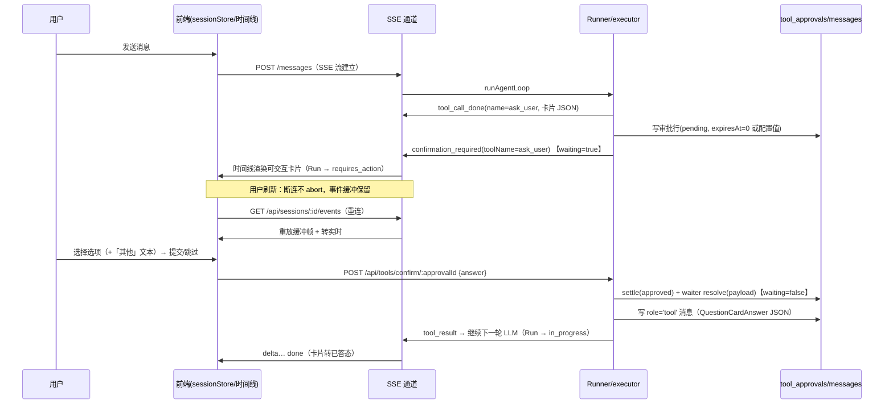

# 问答卡片（ask_user）设计 —— Agent 在回答中向用户发起结构化选择提问

**日期：** 2026-10-31
**状态：** 已确认（2026-10-31 用户逐项拍板六项决策与全部开放问题）——实施计划见 `.omo/plans/question-card-implementation.md`
**分支：** main
**来源：** 2026-10-31 功能需求：允许 agent 在回答中发送问答卡片询问用户，卡片支持单选、多选，以及允许文本输入的自定义「其他」选项
**关联文档：** `docs/rfc/agent-loop-v2.md`（Run 生命周期 / SSE 事件冻结约束）、`docs/2026-07-11-tool-safety-system-design.md`（3 级安全模型与确认流）、`docs/rfc/_architecture-decisions.md`（B6 单循环 + mode hint）、`docs/2026-09-30-attachment-assets-multimodal-design.md`（消息 parts 先例）

---

## 背景与动机

Agent 与用户之间目前只有自由文本一条交互通道。当模型需要用户做「二选一」「多选偏好」「方案拍板」这类决策时，只能用自然语言罗列选项，用户必须打字作答：成本高、易歧义、模型解析自然语言选项也容易出错。

**这个功能的基础设施其实已经存在**。代码级事实：

| # | 已有能力 | 代码位置 |
|---|---------|-----------|
| 1 | Run 生命周期含 `requires_action` 状态（暂停等用户、恢复后继续） | `apps/server/src/agent-loop/run-state.ts`、`packages/shared/src/run.ts`（`RunStatus`） |
| 2 | 工具确认流：执行中暂停 → SSE 通知前端 → 用户决议 → waiter resolve → 循环继续 | `apps/server/src/tools/confirmation.ts`（`requestToolApproval` / `resolveToolApproval`）、`apps/server/src/tools/executor.ts` |
| 3 | 审批记录持久化（含 expiresAt、五态状态机） | `apps/server/src/repo/tool-approval.ts`、`packages/shared/src/tool.ts`（`ToolApproval`：pending/approved/rejected/expired/cancelled） |
| 4 | SSE `confirmation_required` 事件（携带 approvalId、toolName、arguments、expiresAt） | `apps/server/src/streaming/sse-protocol.ts` |
| 5 | 前端确认弹窗 + 决议回传端点 | `apps/web/src/components/ToolConfirmationDialog.tsx`、`apps/server/src/routes/tools.ts:169`（`POST /api/tools/confirm/:approvalId`）、`apps/web/src/store/sessionStore.ts`（`pendingConfirmation` / `resolveConfirmation`） |
| 6 | 工具调用参数流式下发（`tool_call_start/delta/done`），前端时间线已渲染工具条目 | `packages/shared/src/stream-event.ts`、`apps/web/src/components/common/AgentTimeline.tsx` |
| 7 | 工具结果以 `role='tool'` 消息持久化，进入后续轮次 LLM 上下文 | `apps/server/src/agent-loop/runner.ts`（步骤 11） |

**缺的只有两件事：**

1. 把确认通道的「布尔批准」泛化为「携带结构化回答负载的输入请求」；
2. 一个在消息时间线内渲染、可交互的卡片组件（确认弹窗是 modal，问答卡片需要内嵌在对话流里）。

---

## 同类产品调研与对比

### Claude Code —— AskUserQuestion（最直接的对标）

Claude Code 的 `AskUserQuestion` 是与本需求几乎重合的已交付功能。机制：**内置工具调用 + 暂停等待**。模型调用工具时携带 1-4 个问题，每个问题 2-4 个预定义选项，支持 `multiSelect` 多选；终端/客户端渲染成交互表单，**用户答案直接作为 tool result 返回**，agent 在同一回合内继续执行。它还**总是隐式提供一个 "Other" 自由文本选项**——选项都不合适时用户可自行输入。

- 交互文档：https://code.claude.com/docs/en/agent-sdk/user-input
- 工具描述（选项数、multiSelect、Other 语义的权威表述）：https://github.com/Piebald-AI/claude-code-system-prompts/blob/main/system-prompts/tool-description-askuserquestion.md

### OpenAI Agents SDK —— Human-in-the-loop（审批式 HITL）

工具调用按 `needsApproval` 规则触发中断：SDK 暂停 Run、返回 `interruptions`，客户端呈现审批 UI；决策写入后从同一 `RunState` 恢复执行。v1 只有「批准/拒绝」二元决策，可附带文本理由——没有选择题卡片，但**「Run 序列化暂停、恢复」的状态机与本项目的 `requires_action` 同构**。

- JS 版：https://openai.github.io/openai-agents-js/guides/human-in-the-loop/
- Python 版：https://openai.github.io/openai-agents-python/human_in_the_loop/

### OpenAI ChatKit —— Widgets（聊天流内嵌交互组件）

ChatKit 的工具可以通过 `stream_widget` 在回答流中插入结构化 widget（表单、选择器等），用户在聊天流内交互后回调服务端。这是「卡片内嵌在消息流」而非弹窗的产品范本。

- https://openai.github.io/chatkit-python/guides/build-interactive-responses-with-widgets/

### Vercel AI SDK —— Tool Part + Human-in-the-loop

前端框架侧的通用模式：定义一个**不含 `execute` 的工具**，其调用会作为 tool part 流式下发到客户端；客户端渲染自定义 UI（可以是选择题），用户提交后 `addToolResult` 把结果回传，服务端继续生成。AI SDK 6 又加了 `needsApproval` 审批原语。这个模式证明了：**「工具调用 = 可渲染的提问载体」是社区主流做法**，且渲染位置完全由前端决定（消息流内）。

- 工具三种执行模式（含 "Tools that require user interaction"）：https://ai-sdk.dev/docs/ai-sdk-ui/chatbot-tool-usage
- HITL cookbook（拦截工具调用 → 渲染确认 UI → 回传 tool result → 继续）：https://ai-sdk.dev/v5/cookbook/next/human-in-the-loop
- AI SDK 6 `needsApproval`：https://ai-sdk.dev/v5/docs/announcing-ai-sdk-6-beta

### Microsoft Adaptive Cards —— 声明式卡片规范（能力参照系）

`Input.ChoiceSet` 是选择题卡片的成熟 schema 参照：`style: compact`（下拉）/ `expanded`（单选平铺），`isMultiSelect: true` 时渲染为复选框组；自由文本用独立的 `Input.Text`，与 ChoiceSet 组合实现「其他」选项；`Action.Submit` 一次性收集提交。

- Schema：https://adaptivecards.io/explorer/Input.ChoiceSet.html
- Teams SDK 的 ChoiceSetInput（含 label、errorMessage、验证）：https://learn.microsoft.com/en-us/javascript/api/teams-sdk-typescript/@microsoft/teams.cards/choicesetinput?view=msteams-sdk-ts-latest

### Slack Block Kit —— 交互组件与输入面约束

`radio_buttons` / `checkboxes` block 覆盖单选多选；但 `plain_text_input` 输入元素**只能出现在 modal 表面**，普通消息内的自由文本收集受平台限制；交互统一以 payload 回调开发者服务端。

- https://docs.slack.dev/reference/block-kit/block-elements/radio-button-group-element/
- https://docs.slack.dev/reference/block-kit/block-elements/checkboxes-element/
- https://docs.slack.dev/reference/block-kit/block-elements/plain-text-input-element
- https://docs.slack.dev/surfaces/modals/

### 飞书互动卡片 —— 表单容器（中文生态范本）

卡片 JSON 2.0 提供 `select_static`（下拉单选）/多选组件与 `input` 输入框组件；**表单容器**允许把多个交互组件打包，用户本地填写完成后点一次「提交」整体回调开发者服务端；组件支持「表单项标识 + 是否必填」。

- 表单容器：https://open.feishu.cn/document/feishu-cards/card-json-v2-components/containers/form-container
- 输入框组件：https://open.feishu.cn/document/feishu-cards/card-json-v2-components/interactive-components/input
- 列表选择器（select_static 等）：https://open.feishu.cn/document/common-capabilities/message-card/add-card-interaction/interactive-components/selectmenu

### 能力矩阵与启示

| 产品/规范 | 提问载体 | 单选 | 多选 | 自由文本「其他」 | 暂停-恢复机制 | 渲染位置 |
|---|---|---|---|---|---|---|
| Claude Code AskUserQuestion | 内置工具调用 | ✓ | ✓ multiSelect | ✓ 隐式 Other | 工具挂起，答案即 tool result，同回合继续 | 会话流内嵌 |
| OpenAI Agents SDK | 工具审批 | ✓（二元） | ✗ | 文本理由 | RunState 序列化暂停/恢复 | 自定义 UI |
| OpenAI ChatKit | widget 事件 | ✓ | ✓ | ✓ input 组件 | widget 回调 | 聊天流内嵌 |
| Vercel AI SDK | 无 execute 的 tool part | ✓ | ✓ 自实现 | ✓ 自实现 | addToolResult 续跑 | tool part 自定义渲染 |
| Adaptive Cards | 声明式卡片 JSON | ✓ expanded/compact | ✓ isMultiSelect | ✓ + Input.Text | Action.Submit 回调 host | 任意宿主 |
| Slack Block Kit | block 元素 | ✓ | ✓ | ✓（限 modal） | payload 回调服务端 | 消息 block（输入限 modal） |
| 飞书卡片 | select/input 组件 + 表单容器 | ✓ | ✓ | ✓ input 组件 | 表单容器一次回调 | 消息卡片 |

**对本设计的四条启示：**

1. **Agent-native 产品（Claude Code、Vercel、ChatKit）全部选择「工具调用 = 提问载体」**，答案作为 tool result 回流，agent 同一回合内消费答案继续工作。这与本项目 agent-loop + confirmation 架构完全同构——应直接沿用，而不是发明新通道。
2. 平台型产品（Adaptive Cards/Slack/飞书）用「声明式卡片 + 回调」是因为它们没有「运行中的 agent」概念；MyCopilot 有 Run 循环，不需要引入回调表单那套复杂度。
3. **「其他」自由文本是各家标配**：Claude Code 隐式内建，Adaptive Cards 用 ChoiceSet+Text 组合，Slack/飞书用独立输入组件。MyCopilot 用卡片内「其他选项 + 文本输入」组合实现，且按用户确认为模型按需开启。
4. 提问粒度上，Claude Code 允许一次 1-4 题、飞书表单容器一次整表提交；**本项目按用户确认采纳 Claude Code 式一次多题（1..4），整卡一次提交**（见规范 §2）。

---

## 目标

1. 新增内置工具 `ask_user`（Tier 1 Built-in、`safe` 级）：agent 可在回答过程中发起问题卡片，**一次调用 1..4 道题**，每题单选或多选。
2. 卡片支持「其他」自定义选项：勾选后出现文本输入框，随选择一并提交（模型按需开启）。
3. 用户答案作为工具结果回流到当前 Run，**agent 同回合内继续**，无需用户新发一条消息。
4. 完全复用既有确认基础设施：不新增 SSE 事件类型、不新增数据表；新增 REST 端点 `GET /api/tools/pending`、`GET/PUT /api/settings/ask-user`，以及 SSE 重连端点 `GET /api/sessions/:id/events`；既有 `POST /api/tools/confirm/:approvalId` 请求体向后兼容扩展。
5. 已回答的卡片在历史消息回放（刷新、重开会话）中以只读摘要形态呈现，不显示原始 JSON，不可重复触发。
6. **刷新页面不丢弃 pending 卡片**：等待期断连不中止 Run，事件缓冲 + SSE 重连恢复，卡片依旧是会话消息数据的一部分。
7. 遵守 `docs/rfc/agent-loop-v2.md` 的「扩展而非重定义」合规条款：Run 状态机、11+1 种 SSE 事件、LoopGuard、stop_reason 路由零改动。

## 非目标

- **不做开放式表单**（多个自由文本字段、文件上传等）——自由文本仅限「其他」选项。
- **不新增 SSE 事件类型**；`confirmation_required`、`tool_call_*`、`tool_result` 语义原样复用。
- **异步 job 模式（`AGENT_ASYNC_MODE=true`）**：卡片恢复（pending 列表）与作答（confirm 端点，waiter 在 job 进程内）完整可用；回答后卡片即时切换已答态，续写内容随 job 完成后的消息重载可见。异步模式本身无逐 token 直播（job /stream 仅推状态），本设计不为其新增直播能力。
- 卡片选项不支持 markdown/图片渲染；不支持选项分组、拖拽排序、选项级防抖确认等 Adaptive Cards 级别的富能力。
- **不做条件分支**（选 A 则追问 A1）——属于 Artifact/表单子系统方向（决策 B7/A1 的 frontend-response 愿景）。
- 不做移动端专项适配与无障碍全量审计（基础 ARIA 语义在规范 §7 内要求）。
- 不提供 Mock 演示样本。

---

## 候选方案对比与决策

### 方案 A：内置工具 + 确认通道泛化（已确认采纳）

`ask_user` 作为普通内置工具进入广告列表；模型调用它 = 发起提问。executor 不执行任何逻辑，而是挂起等待用户输入（复用 `requestToolApproval` 的 waiter/持久化/超时机制，泛化为可携带回答负载）；前端把 `toolName === 'ask_user'` 的 `confirmation_required` 事件渲染为时间线内的交互卡片而非弹窗；答案经 `POST /api/tools/confirm/:approvalId` 回传，成为 tool result，Run 继续。

- 优点：零新协议、零新表；Run 生命周期（`requires_action`）原生支持；同步/异步 job 模式的骨架都已存在；工具调用参数流式下发使卡片可以渐进渲染；答案天然进入 LLM 上下文（`role='tool'` 消息）。
- 既有缺点（已由用户决策 #6 根治）：同步模式刷新原会断流中止 Run——现以「等待期断连豁免 + 事件缓冲 + SSE 重连」解决（见边界 §3 与规范 §6）。

### 方案 B：消息 part 卡片（无暂停）—— 否决记录

卡片作为 assistant 消息的一种 `MessagePart`（扩展 `attachment.ts` 的 parts 联合类型）流式下发；Run 正常结束。用户点击提交后，前端发送一条普通 user 消息（附结构化 answer part），开启新 Run。模型在下一轮才看到答案。

- 优点：无长连接挂起，刷新无感；实现简单。
- 缺点：① 模型问完即结束回合，无法基于答案在同一回合行动（Claude Code 式「问-答-继续」体验断裂）；② 回答与卡片在数据模型上无强关联（靠约定），重放、幂等、防重复提交都要新造机制；③ 与既有的 `requires_action` 基础设施平行，造出第二条人机交互通道，长期维护两套。

### 方案 C：文本围栏协议（```ask_user JSON```）—— 否决记录

在 system prompt 约定模型输出 ```` ```ask_user ```` 围栏 JSON，前端或服务端拦截渲染。供应商无关、实现快。

- 缺点：脆弱（模型格式漂移、围栏泄漏到正文）；与已有 function-calling 管道平行；无法承载「等待-恢复」语义（只能配合方案 B 的回答回路）。RFC agent-loop-v2 ADR-003 已经否决过同类内联标记方案（`<think>` 反例），理由同样适用。

### 决策

**采纳方案 A**（用户已确认）。它与本项目已验证的 agent-loop 架构同构（启示 1），改动面最小且全部是加法；方案 B/C 作为对照记录在案。若未来出现「无 Run 场景的卡片」（如设置页引导），可再评估方案 B 作为独立补充。

---

## 规范

### 1. 数据模型（`packages/shared/src/question-card.ts`，已落地）

```ts
/** 卡片单题提问模式：single = 单选（radio），multiple = 多选（checkbox）。 */
export type QuestionCardMode = 'single' | 'multiple';

/** 卡片内的单道题。选项在同一题内以 label 文本为身份（要求唯一）。 */
export interface QuestionCardQuestion {
  /** 问题文本（≤ 500 字符）。 */
  question: string;
  /** 问题补充说明（可选，≤ 1000 字符）。 */
  description?: string;
  mode: QuestionCardMode;
  /** 选项文案数组（2..6 项，各 ≤ 100 字符）。 */
  options: string[];
  /** 与 options 等长的补充说明数组（可选，按索引对齐，各 ≤ 200 字符）。 */
  optionDescriptions?: string[];
  /** 是否提供「其他」自由文本选项。缺省 false（模型按需开启）。 */
  allowCustomOption?: boolean;
  /** 自定义选项文案，缺省「其他」（≤ 20 字符）。 */
  customOptionLabel?: string;
}

/** ask_user 工具调用 arguments 的结构化形态：一次调用 1..4 道题。 */
export interface QuestionCardSpec {
  questions: QuestionCardQuestion[];
}

/** 卡片内单道题的用户回答。 */
export interface QuestionAnswerEntry {
  /** 对应 QuestionCardSpec.questions 的数组下标。 */
  index: number;
  /** answered = 正常作答；skipped = 用户跳过整卡时逐题标记。 */
  status: 'answered' | 'skipped';
  /**
   * 选中选项的 label 列表；选择自定义选项时为其实际文案（customOptionLabel），
   * 此时 customText 必填（≤ 2000 字符）。skipped 时为空数组。
   */
  selections: string[];
  customText?: string;
}

/** ask_user 工具结果（role='tool' 消息 content 的 JSON 形态，模型与前端回放共用）。 */
export interface QuestionCardAnswer {
  status: 'answered' | 'skipped' | 'expired' | 'cancelled';
  /** answered/skipped 时逐题一条；expired/cancelled 时为空数组。 */
  answers: QuestionAnswerEntry[];
  /** ISO 8601 时间戳（answered/skipped 时携带）。 */
  answeredAt?: string;
}

/** 卡片尺寸上限（服务端校验与前端 maxLength 的单一事实源）。 */
export const QUESTION_CARD_LIMITS = {
  minQuestions: 1,
  maxQuestions: 4,
  minOptions: 2,
  maxOptions: 6,
  maxQuestionChars: 500,
  maxDescriptionChars: 1000,
  maxOptionChars: 100,
  maxOptionDescriptionChars: 200,
  maxCustomLabelChars: 20,
  maxCustomTextChars: 2000,
} as const;

/** 设置存储键（config 表）：ask_user 等待超时毫秒数；'0' 或缺省 = 不超时（挂起）。 */
export const ASK_USER_TIMEOUT_CONFIG_KEY = 'ask_user_timeout_ms';
```

**持久化形态（无新表）：** 提问 = assistant 消息的 `toolCalls[]` 之一（`arguments` 为 `QuestionCardSpec` 的 JSON 字符串，`packages/shared/src/session.ts` 的 `ToolCall`）；回答 = 对应 `role='tool'` 消息的 `content`（`QuestionCardAnswer` 的 JSON 字符串，`toolCallId` 关联）。`messages` 表现有列足以承载，零 schema 迁移。

### 2. 工具定义与注册（`apps/server/src/tools/builtins/ask-user.ts`，新文件）

```ts
// 注册：apps/server/src/tools/builtins/index.ts 的 builtinExecutors 增加
{ name: 'ask_user', executor: askUserExecutor }
```

- **安全级别：`safe`**。提问本身无副作用，不触发既有确认流（它自身就是交互）。
- **description 携带使用指引**（对标 Claude Code 的 tool description 实践，这是控制模型行为的主要手段）：
  - 当需要用户在明确选项间做决策、澄清歧义需求、收集偏好时使用；
  - 一次调用 1..4 道题；开放式问题（无自然选项集）不要用本工具，直接用文本提问；
  - 每题选项 2-6 个，文案互斥、具体、简短；`allowCustomOption` 用于「以上都不是/用户有自定义答案」的场景；
  - 调用后本回合会暂停等待用户回答，答案将作为工具结果返回。
- **参数 schema**（`ToolInputSchema` 单数组字段，无需扩展 schema 能力）：

| 字段 | 类型 | 必填 | 说明 |
|---|---|---|---|
| `questions` | array（items: object） | ✓ | 题目数组，1..4 项；每题形状 `{question, description?, mode:'single'\|'multiple', options:[2..6 字符串], optionDescriptions?（等长）, allowCustomOption?, customOptionLabel?}`，完整 JSON 形状写在工具 description 中（模型遵循 description 是主要手段，对标 Claude Code 的 tool description 实践） |

**粒度决策（一次多题，用户已确认）：** 一次工具调用携带 1..4 道题，整卡一次提交；避免模型连发多卡导致多轮等待。与既有 `ToolInputSchema` 的兼容靠「单数组字段 + description 形状说明」实现，零 schema 扩展。

### 3. Server 执行路径（`apps/server/src/tools/confirmation.ts` 泛化）

**现状：** `requestToolApproval` 挂起等待一个布尔决议（`ApprovalWaiter.resolve: (approved: boolean) => void`），danger/restricted 工具经 `executor.ts` 的确认分支走此路径。

**泛化（加法）：**

1. waiter 签名扩展为 `resolve(approved: boolean, payload?: string)`；`resolveToolApproval(approvalId, approved, payload?)` 第三参数可选，不传时行为与现状一致。
2. 新增 `requestUserQuestion(params)`：与 `requestToolApproval` 同构（写 `tool_approvals` 行 → `onRequired` 回调通知 SSE → 挂起 waiter → 超时/中止处理），但语义为「等待回答」：
   - 审批行 `toolName='ask_user'`、`safetyLevel='safe'`、`arguments` = `QuestionCardSpec` JSON；
   - 用户回答：`settleToolApproval(id, 'approved')` + payload = `QuestionCardAnswer` JSON（含 `answeredAt`）→ executor 返回 `textResult(answerJson)`；
   - 超时（仅当配置了超时）：`settleToolApproval(id, 'expired')` → 工具结果 `{status:'expired',answers:[]}`（**isError=false**，让模型自行决定后续，不炸循环）；
   - 用户停止/断流（活跃生成期）：abort 信号 → `cancelled` → 工具结果 `{status:'cancelled',answers:[]}`。
3. **默认不设超时（挂起等待）**；`config` 表键 `ask_user_timeout_ms`（设置页「通用」可配置开关与时长）：缺省/'0' = 无超时（`expiresAt=0`，不启动计时器）；>0 时到期 settle 'expired' → 工具结果 `{status:'expired',answers:[]}`（isError=false），Run 继续。既有工具确认（danger/restricted）保持 300 秒默认不变。
4. `ask_user` executor 通过 `ToolExecutionContext` 既有的 `onConfirmationRequired` / `onConfirmationSettled` 回调通道发起与收尾（runner 步骤 10 已为每个工具调用挂好该回调并同步驱动 Run 状态机 `in_progress → requires_action → in_progress`），runner 主循环**零改动**。

**幂等/并发：** 同一 Run 内模型可并行发起多个 `ask_user` 调用（`Promise.all` 既有行为），每张卡片有独立 `approvalId`、独立等待、独立提交。同一 approvalId 二次提交由 `settleToolApproval` 的状态机拒绝（已 settled 返回空 → 404，见 §5）。

### 4. API 变更（`apps/server/src/routes/tools.ts` + 新 `routes/settings.ts`）

`POST /api/tools/confirm/:approvalId` 请求体扩展（向后兼容）：

```jsonc
// 现状（非 ask_user 工具）：{ "approved": true | false }
// 扩展后（ask_user 审批）:
{
  "answer": {
    "status": "answered",
    "answers": [
      { "index": 0, "status": "answered", "selections": ["方案 A"] },
      { "index": 1, "status": "answered", "selections": ["其他"], "customText": "想试试 SQLite，单机就够" }
    ]
  }
}
// 卡级跳过：{ "answer": { "status": "skipped", "answers": [逐题 {"index":i,"status":"skipped","selections":[]}] } }
```

服务端校验（对照审批 `arguments` 中的 `QuestionCardSpec`）：answered 时每题 index 有效、`selections` 非空且每个值都属于该题 options ∪ 自定义项文案、选自定义项则 `customText` 必填且 ≤ 2000 字符；skipped 时逐题 `status:'skipped'`、空 selections。校验失败返回 400；审批不存在或已 settled 返回 404（前端随即锁定卡片）。**回答不产生 user 消息、不合成任何伪造消息**——对话流中的记录就是 assistant 消息（提问）+ tool 消息（回答），与工具确认的持久化形态一致。

新增端点：

| 端点 | 语义 |
|---|---|
| `GET /api/tools/pending?sessionId=<id>` | 该会话 pending 审批列表 `{approvals:[{approvalId, toolCallId, toolName, arguments, expiresAt, createdAt}]}`——前端刷新后据此还原可交互卡片/确认弹窗（`expiresAt=0` 表示无超时） |
| `GET /api/settings/ask-user` / `PUT /api/settings/ask-user` | 读取/保存 `{timeoutMs: number\|null}`（null/0 = 不超时；正数上限 7 天），存 `config` 表键 `ask_user_timeout_ms`；admin-only（不进 demo 白名单） |
| `GET /api/sessions/:id/events`（SSE） | 重连端点：无活动 Run → `event: idle` 后关闭；有 → 重放该 Run 已缓冲的全部 SSE 帧后转实时推送，终止事件后关闭（实现见 §6） |

### 5. SSE 与前端状态（零新事件）

| 阶段 | 既有事件 | 前端行为 |
|---|---|---|
| 模型生成提问 | `tool_call_start` → `tool_call_delta`（argumentsDelta 流式） | 时间线 ask_user 条目显示「正在生成问题…」骨架；可选做 arguments 部分解析渐进渲染题干 |
| 提问就绪 | `tool_call_done`（name='ask_user'，arguments=卡片 JSON） | 时间线 ask_user 条目渲染为完整交互卡片 |
| 暂停等待 | `confirmation_required`（approvalId、toolName='ask_user'、expiresAt=0 表示无超时） | `sessionStore` 新增 `pendingQuestion`（与 `pendingConfirmation` 并列）；卡片进入可交互态；**弹窗 `ToolConfirmationDialog` 对 ask_user 不弹出**（按 toolName 分流） |
| 用户提交/跳过 | `POST /api/tools/confirm/:approvalId` | 卡片锁定为提交中；`pendingQuestion` 清空 |
| 答案回流 | `tool_result`（result=`QuestionCardAnswer` JSON） | 时间线 ask_user 条目从 `entry.result` 读回答，渲染已答/跳过态（选中项高亮 + 摘要行） |
| 继续生成 | `delta` / `done` | 既有行为，Run 状态机自动从 `requires_action` 回到 `in_progress` |

**等待期断连豁免与重连（用户决策 #6 的实现核心，streaming 层改动）：**

1. registry（`streaming/registry.ts`）为每个活动 Run 维护：**事件缓冲**（本 Run 全部 SSE 帧的有序列表，容量封顶淘汰最旧 delta）与 **waiting 标志**。lifecycle 的 `handleAgentEvent` 在 `tool_confirmation_required` 时置 `waiting=true`（ask_user 与普通工具确认一视同仁），`tool_confirmation_settled` 与终态时置回 `false`。
2. `stream.onAbort`（lifecycle）改为：**仅当 `waiting=false` 时 abort**（活跃生成期断连维持现状）；等待期断连只解除挂接，Run 与 waiter 原地继续等用户。
3. 新端点 `GET /api/sessions/:id/events`：registry 有活动 Run → 先重放缓冲帧、再挂接为实时 sink；无 → `event: idle` 后关闭。前端在发现 pending（或会话加载时）打开它，续写实时到达。
4. `AgentState` 前端状态机（RFC §7 投影）无需新状态：`tool_call_start/done` 已覆盖提问阶段，等待期停留于 `tool_running`（语义正确：Run 确实在等工具）。

### 6. 卡片 UI 交互规范（`apps/web/src/components/QuestionCard/`，新组件目录）

- **结构**：卡片含 1..4 个题块（题干加粗 + 可选说明次级文本 + 选项列表），卡级「提交回答」与「跳过回答」按钮。每题必答：提交时每题至少选一项；「跳过回答」将整卡按 `status:'skipped'` 逐题标记提交。
- **单选**（`mode='single'`）：原生 `input[type=radio]` + 样式定制，`role="radiogroup"`；「其他」为一个 radio 选项，选中后其下方文本输入框获得焦点且必填。
- **多选**（`mode='multiple'`）：`input[type=checkbox]` 组；至少选一项才可提交；「其他」为 checkbox，选中启用文本输入框。
- **「其他」文本**：`maxLength` 取 `QUESTION_CARD_LIMITS.maxCustomTextChars`，placeholder 引导（如「请输入你的答案…」）；含前后空白 trim。
- **提交**：选中项以 label 文本组装 `QuestionCardAnswer`；提交中禁用全部控件；成功后卡片转已答态。
- **已答态（只读回放）**：选中项高亮 + check 标记；自定义回答在「其他」下方展示文本；显示回答时间。数据来源：时间线条目 `result`（在线）或 DB 重建（刷新后，见 §7）。
- **失效态**：超时/中止/服务端重启（无回答、无活动审批）的卡片显示灰化摘要行（「该提问未获得回答」），不可交互。
- **多卡片**：同一消息时间线内多张 pending 卡片并存时各自独立交互、独立提交，互不阻塞。
- **安全**：`question/description/label/customText` 均为不可信的模型生成文本——纯文本渲染（React 默认转义），禁止 `dangerouslySetInnerHTML` 与 markdown 渲染；尺寸上限见 §8。
- **超时配置 UI**：设置中心新增「通用」分类页（`views/settings/GeneralSettingsPage.tsx` + `SettingsShell.SECTIONS` 一行 + router 子路由）：「问答卡片等待超时」开关 + 时长输入（秒，1..604800），存 `config` 表。

### 7. 历史回放与重建

刷新/重开会话后，前端经 `utils/timeline.ts` 从 DB 消息重建时间线（现状已从 assistant 消息 `toolCalls` + tool 消息重建工具条目）。规范：

- 重建逻辑识别 `toolCalls` 中 `name='ask_user'` 的条目 → 生成卡片条目；从关联 tool 消息（`toolCallId` 匹配）读取 `content` 解析 `QuestionCardAnswer`；
- 有回答/跳过 → 已答/跳过只读态；有 `expired/cancelled` 结果 → 失效态；无结果且 **不在** `GET /api/tools/pending` 活动列表（Run 已死，如服务端重启）→ 失效态；
- 无结果且**在** pending 列表 → 可交互态（与重连流配合，见 §5）；
- **已答卡片永不可复活**：回答只能发生在暂停等待期（幂等由 `settleToolApproval` 状态机 + 404 兜底）。这是有意的——重放场景下重新打开旧提问会让 Run 上下文错位。

### 8. 校验、上限与安全（服务端为准，前端为辅）

| 项 | 上限 | 超限行为 |
|---|---|---|
| 题目数 | 1..4 | 400 |
| `question` | 500 字符 | 400 |
| `description` | 1000 字符 | 400 |
| 选项数（每题） | 2..6 | 400 |
| 选项 label | 100 字符，题内唯一 | 400 |
| 选项 description | 200 字符 | 400 |
| `customOptionLabel` | 20 字符 | 用默认值「其他」 |
| `customText` | 2000 字符 | 400 |
| 单条 Run 内 ask_user 调用数 | 不硬限（LoopGuard 步数/重复检测兜底） | — |

工具参数解析失败（非法 JSON、缺必填、超限）：executor 返回 `errorResult`（isError=true），模型收到显式错误可自行修正重试——与现有内置工具的参数校验行为一致（参照 `read-session.ts` 的 `requiredString` 模式）。

### 9. 交互时序（同步模式，默认）



---

## 边界与反例

1. **反例：把回答合成一条 user 消息。** 会伪造对话记录（用户并未打字），且与「工具结果持久化」的既有语义冲突。回答只存在于 tool 消息与卡片已答态中。
2. **反例：为问答新增第 13 种 SSE 事件（如 `question_required`）。** `confirmation_required` 已携带全部所需字段（approvalId、toolName、arguments、expiresAt），前端按 `toolName` 分流即可。agent-loop-v2 已为同类需求确立「扩展可选字段而非新事件」的合规方向（ADR-003），实现中的 `reasoning` 第 12 事件已被记档为偏差（`docs/rfc/future-work.md` §11），不应再增。
3. **同步模式下刷新页面不再作废提问（用户硬性要求）**：实现为「等待期断连豁免 + 事件缓冲 + SSE 重连」——Run 进入等待（`tool_confirmation_required`，含 ask_user 与普通工具确认）时，客户端断连只解除挂接不 abort；SSE 事件全量缓冲于 registry（每会话一份），新端点 `GET /api/sessions/:id/events` 重放缓冲后转实时；前端加载会话时经 `GET /api/tools/pending?sessionId=` 发现 pending 卡片/确认，渲染为可交互并打开重连流，回答后续写实时到达。Run 活跃生成期间断连仍按现状 abort（避免无人观看的 Run 空转）。服务端重启仍会丢等待（waiter 在内存），重启后卡片呈失效态。
4. **服务端重启丢等待。** waiter 在内存中（`approvalWaiters` Map），重启后 pending 审批无人唤醒；无超时配置下审批行保持 pending 直至进程退出。现状确认流相同；`clearPendingConfirmations` 的既有清理语义沿用，重启后卡片呈失效态。
5. **反例：卡片选项支持 markdown/HTML 渲染。** 选项文本是 LLM 输出（不可信输入），富文本渲染制造注入面；纯文本 + 转义是唯一正确姿态。
6. **多选与「其他」组合的空值**：选了「其他」但文本为空 → 前端禁止提交；绕过前端直接 POST → 服务端 400。
7. **模型在无选项可给时滥用 ask_user**（如「帮我写首诗吗？」这种开放问题也出卡片）：靠工具 description 指引约束 + 上限兜底；不追求硬性拦截。
8. **反例：浏览历史时重复触发。** 已答卡片只读（数据源 = 持久化 tool 消息），失效卡片不可交互（无活动审批即灰化），pending 卡片只在有活动 waiter 时可交互——任何回放路径都不会产生新的等待。

---

## 实施计划（分阶段，每阶段可独立合入）

| 阶段 | 内容 | 触及面 |
|---|---|---|
| P0 | `shared`：`question-card.ts` 新模块（类型 + `QUESTION_CARD_LIMITS` + `ASK_USER_TIMEOUT_CONFIG_KEY`） | `packages/shared` |
| P1 | `server`：`builtins/ask-user.ts`（校验、description 指引）；`confirmation.ts` 泛化（payload、`requestUserQuestion`、config 超时）；`routes/tools.ts`（answer 契约 + pending 列表）；`routes/settings.ts`（超时配置）；`streaming/`（等待期豁免 + 缓冲 + 重连端点）；tokenAuth demo 规则 | `apps/server/src` |
| P2 | `web`：`QuestionCard/` 组件（多题/单选/多选/其他/skip/已答/失效五态）；`sessionStore`（pendingQuestion + 恢复 + 可复用流处理器）；`AgentTimeline` 分流；`timeline.ts` 回放重建；api 层；设置页 | `apps/web/src` |
| P3 | 测试补齐 + 工具 description 调优 + 真实表面 QA（mock LLM 全链路 + 浏览器） | 全栈 |

依赖顺序 P0 → P1 → P2 → P3；P1 完成后即便 P2 未合入，模型调用 ask_user 也只是回落为普通工具调用（前端显示原始参数），不会破坏现有体验——符合「契约优先、行为渐进」的迁移惯例。

## 测试计划

- **server 单测**：ask-user 参数校验矩阵（§8 全部上限）；`requestUserQuestion` 的 answered/skipped/expired/cancelled 四路 + 默认无超时（fake timers 推进无到期）；`POST /confirm` 携带/不携带 answer 的向后兼容；二次提交幂等（404）；GET /pending 过滤。
- **server 集成**：runner 集成测试新增「ask → answer → 循环继续（答案进入下一轮 LLM 消息）」与「ask → 配置超时 → expired → 继续」两例。
- **web 组件测试**（Vitest + jsdom）：QuestionCard 单选/多选/其他文本联动/提交与跳过 payload/提交后锁定/已答回放/失效态；timeline ask_user 分流与 DB 回放重建；sessionStore pendingQuestion 转移。
- **测试纪律**：超时路径用 vi.useFakeTimers 驱动，禁止真实 sleep；提交-回流用受控 promise 而非轮询。
- **手工/真实表面验收**：mock LLM 全链路（含「其他」文本、跳过、超时）、刷新后恢复、停止按钮中止、并行双卡片、桌面/移动宽度。

## 决策记录（用户已确认，2026-10-31）

| # | 决策点 | 用户结论 |
|---|---|---|
| 1 | 总体架构 | **方案 A**：内置工具 + 确认通道泛化（Run 暂停，同回合继续） |
| 2 | 提问粒度 | **一次多题**：`questions[]` 1..4，整卡一次提交 |
| 3 | 超时 | **默认不设超时（挂起）**；设置页可配置是否超时及时长；到期工具返回 expired、Run 继续 |
| 4 | 「其他」选项 | 模型按需开启（`allowCustomOption`） |
| 5 | 回答持久化形态 | tool 消息 + 卡片已答态，不产生 user 消息；历史回放只读、不可重复触发 |
| 6 | 刷新丢 pending 卡片 | **不允许丢弃**：等待期断连豁免 + 事件缓冲 + SSE 重连 + pending 列表还原 |
| 开放问题 1 | 超时值 | 可配置（设置页） |
| 开放问题 2 | 异步 job 模式 | 一起做：卡片恢复 + 作答 + 完成后消息重载 |
| 开放问题 3 | 跳过按钮 | 需要（卡级跳过） |
| 开放问题 4 | 多题/条件分支 | 需要多题（本次实现）；条件分支仍不做 |

## 参考文献

- Claude Code 交互与用户输入（AskUserQuestion 机制）：https://code.claude.com/docs/en/agent-sdk/user-input
- Claude Code AskUserQuestion 工具描述全文：https://github.com/Piebald-AI/claude-code-system-prompts/blob/main/system-prompts/tool-description-askuserquestion.md
- OpenAI Agents SDK（JS）Human-in-the-loop：https://openai.github.io/openai-agents-js/guides/human-in-the-loop/
- OpenAI Agents SDK（Python）Human-in-the-loop：https://openai.github.io/openai-agents-python/human_in_the_loop/
- OpenAI ChatKit 交互式 widget：https://openai.github.io/chatkit-python/guides/build-interactive-responses-with-widgets/
- Vercel AI SDK Chatbot Tool Usage（三种工具执行模式）：https://ai-sdk.dev/docs/ai-sdk-ui/chatbot-tool-usage
- Vercel AI SDK Human-in-the-loop Cookbook：https://ai-sdk.dev/v5/cookbook/next/human-in-the-loop
- AI SDK 6 Beta（needsApproval）：https://ai-sdk.dev/v5/docs/announcing-ai-sdk-6-beta
- Adaptive Cards Input.ChoiceSet Schema：https://adaptivecards.io/explorer/Input.ChoiceSet.html
- Teams ChoiceSetInput：https://learn.microsoft.com/en-us/javascript/api/teams-sdk-typescript/@microsoft/teams.cards/choicesetinput?view=msteams-sdk-ts-latest
- Slack Block Kit radio/checkbox/plain-text-input/modals：https://docs.slack.dev/reference/block-kit/block-elements/radio-button-group-element/ 、https://docs.slack.dev/reference/block-kit/block-elements/checkboxes-element/ 、https://docs.slack.dev/reference/block-kit/block-elements/plain-text-input-element 、https://docs.slack.dev/surfaces/modals/
- 飞书卡片表单容器 / 输入框 / 列表选择器：https://open.feishu.cn/document/feishu-cards/card-json-v2-components/containers/form-container 、https://open.feishu.cn/document/feishu-cards/card-json-v2-components/interactive-components/input 、https://open.feishu.cn/document/common-capabilities/message-card/add-card-interaction/interactive-components/selectmenu
- 内部：`docs/rfc/agent-loop-v2.md`、`docs/2026-07-11-tool-safety-system-design.md`、`docs/rfc/_architecture-decisions.md`、`docs/rfc/future-work.md`
